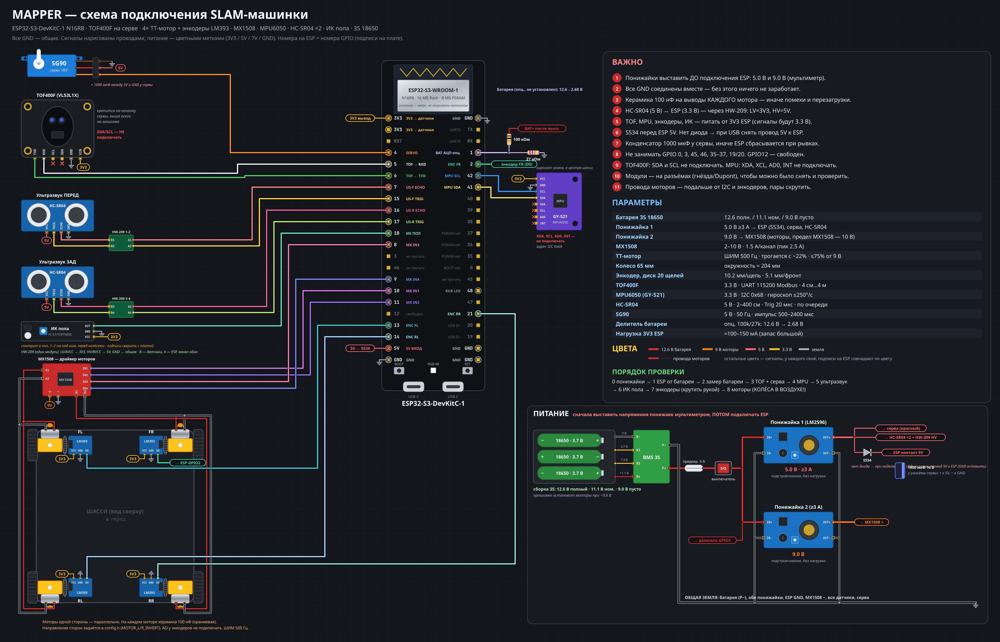

# mapper — SLAM-машинка на ESP32-S3

Машинка на гусеничном принципе (4 мотора TT, поворот разностью сторон) сканирует комнату
лазерным дальномером TOF400F на серве. Программа на компе строит 2D-карту, уточняет по сканам
положение машинки, по клику на карте прокладывает маршрут (A*), и машинка едет туда, объезжая
препятствия. Управлять можно с компа (WASD) и с телефона (джойстик в браузере).



## Что внутри

| Часть | Что делает |
|---|---|
| ESP32-S3-DevKitC-1 N16R8 | мозг машинки, Wi-Fi |
| TOF400F (VL53L1X) на SG90 | дальномер до 4 м, серва поворачивает его 0–180° |
| 4× мотор TT + колёса 65 мм | ходовая, левая/правая сторона — параллельно |
| MX1508 | драйвер моторов (2 канала) |
| 4× энкодер LM393 (диск 20 щелей) | одометрия, скорость каждой стороны |
| MPU6050 (GY-521) | гироскоп — курс |
| 2× HC-SR04 + HW-209 | ультразвук спереди/сзади (защита), через преобразователь уровней 5↔3.3 В |
| FC-51 (ИК) | датчик пола — не упасть со ступеньки/стола |
| 3S 18650 + 2 понижайки | 5 В (электроника, серва) и 7 В (моторы) |

Подробно: [docs/HARDWARE.md](docs/HARDWARE.md).

## Быстрый старт

### 1. Без железа — симулятор
```bash
cd ~/mapper/pc
python3 -m venv .venv && .venv/bin/pip install -r requirements.txt   # один раз
.venv/bin/python -m mapper.sim       # терминал 1 — виртуальная машинка
.venv/bin/python -m mapper.server    # терминал 2 — программа
```
Открыть http://localhost:8080 → «Скан» → клик по карте.

### 2. Прошивка машинки
```bash
cp include/secrets.h.example include/secrets.h   # вписать Wi-Fi 2.4 ГГц (5 ГГц ESP32 не видит)
pio run -t upload                                # по USB
pio run -e mapper-ota -t upload                  # дальше — по Wi-Fi
```

### 3. Работа
```bash
cd ~/mapper/pc && .venv/bin/python -m mapper.server
```
Открыть адрес, который напечатает сервер (`http://<ip-компа>:8080`), на компе или телефоне в той же сети.
Машинка находит комп сама. Светодиод на ESP: зелёный — всё на связи.

Чтобы сервер запускался сам: [docs/PC.md → автозапуск](docs/PC.md#автозапуск-systemd).
На Linux с ufw нужно открыть порты: `sudo ufw allow 4210/udp && sudo ufw allow 8080/tcp && sudo ufw allow 3233/tcp`.

## Структура

```
mapper/
├── README.md                 этот файл
├── platformio.ini            сборка: mapper (основная), mapper-ota, тесты sensortest/drivetest/ustest
├── docs/
│   ├── wiring.png / .svg     схема подключения (генерируется wiring_gen.py)
│   ├── HARDWARE.md           детали, распиновка, питание, сборка
│   ├── FIRMWARE.md           устройство прошивки, настройки, прошивка, тестовые прошивки
│   ├── PROTOCOL.md           протокол машинка ↔ комп (UDP JSON)
│   ├── PC.md                 программа на компе: карта, совмещение сканов, маршруты, интерфейс
│   └── CALIBRATION.md        калибровка, что уже проверено, поиск неисправностей
├── include/
│   ├── config.h              пины и калибровка
│   └── secrets.h.example     шаблон Wi-Fi (secrets.h — не в архиве)
├── src/                      прошивка ESP32-S3
│   ├── main.cpp              запуск, главный цикл, светодиод
│   ├── hw.*                  моторы, энкодеры, гироскоп, ультразвук, ИК, батарея, серва
│   ├── tof.*                 TOF400F (Modbus RTU)
│   ├── robot.*               одометрия, регуляторы, маршрут, скан, защита
│   ├── net.*                 Wi-Fi, UDP, прошивка по воздуху
│   ├── cli.*                 консоль в мониторе порта
│   ├── sensortest.cpp        тест датчиков (своя Wi-Fi сеть + страница)
│   ├── drivetest.cpp         тест ходовой (WASD со страницы на машинке)
│   └── ustest.cpp            простой тест ультразвуков
├── pc/
│   ├── mapper/               сервер, карта, совмещение, A*, симулятор
│   ├── web/index.html        интерфейс (комп + телефон)
│   └── mapper.service        служба systemd для автозапуска
```

## Состояние (2026-11-06)

Собрано и проверено на машинке: Wi-Fi и связь с компом, TOF, MPU6050, оба ультразвука,
ИК пола, моторы (направление, ШИМ 500 Гц), 4 энкодера, серва, прошивка по воздуху.

Известное:
- энкодер переднего правого колеса иногда теряет контакт — пропаять/обжать провод
  (прошивка переживает: берёт скорость с заднего колеса той же стороны);
- делитель батареи не установлен — заряд не контролируется, следить вручную (3S: не ниже 9.6 В);
- диода SS34 нет — при подключении USB снимать провод 5V к ESP;
- скан и езда по маршруту на реальной машинке ещё в отладке.

Подробности и журнал проверки: [docs/CALIBRATION.md](docs/CALIBRATION.md).
